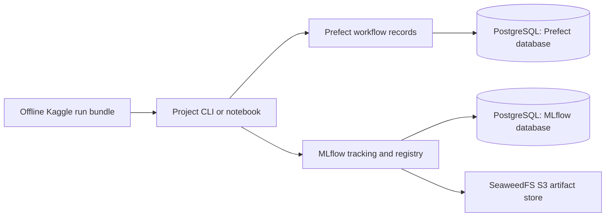

# MLOps Platform

One infrastructure repository for independently runnable ML projects. **Prefect records workflow execution; MLflow records experiments and model versions; PostgreSQL stores metadata; SeaweedFS stores model artifacts behind MLflow's HTTP proxy.** Training code, dependencies, datasets, and benchmark results remain in each project repository.

The shared deployment already used by the projects is being adopted without replacing its data. MLflow is available to local clients at `http://127.0.0.1:5500`; its existing PostgreSQL and SeaweedFS volumes remain untouched. A separately managed Prefect installation is outside this repository's operational ownership. The portable Compose stack below is a tested reference for fresh deployments, **not an instruction to launch a second permanent stack alongside existing services**. See [deployment ownership and adoption](docs/adoption.md).



Clients receive the MLflow and Prefect endpoints and their application credentials. They do not need database passwords or S3 keys. Offline Kaggle runs export evidence for a later import; private infrastructure is not required inside the hosted notebook.

## Project identities

[configs/projects.json](configs/projects.json) is the authority for logical names. Clients use these stable names without importing platform configuration at runtime.

| Project | GitHub repository | MLflow experiment | Prefect deployment | Artifact namespace |
|---|---|---|---|---|
| Iceberg | [kaggle-iceberg-solution-mlops](https://github.com/cttsai1985/kaggle-iceberg-solution-mlops) | `kaggle/iceberg` | `kaggle-iceberg/local` | `projects/iceberg` |
| Home Credit | [kaggle-home-credit-solution-mlops](https://github.com/cttsai1985/kaggle-home-credit-solution-mlops) | `kaggle/home-credit` | `kaggle-home-credit/local` | `projects/home-credit` |
| QUEST | [kaggle-quest-solution-mlops](https://github.com/cttsai1985/kaggle-quest-solution-mlops) | `kaggle/quest` | `kaggle-quest/local` | `projects/quest` |
| Quant research collection | [kaggle-quant-collections](https://github.com/cttsai1985/kaggle-quant-collections) | `kaggle/quant-research` | `kaggle-quant-research/local` | `projects/quant-research` |

Prefect deployment names and registered-model names (`kaggle-<project>`) are reserved conventions, not a claim that every project has been deployed or promoted. The collection may use `kaggle/quant-research/<competition-slug>` child experiments and competition/solution tags; existing experiment names remain valid historical records.

The portable stack provisions experiments with `mlflow-artifacts:/projects/<project>`. Its physical bucket is `mlops-artifacts`. The adopted deployment keeps its existing `mlflow` bucket: proxy URIs let clients retain the same logical namespace without a storage migration.

## Verify the platform

Requirements: Docker Engine with Compose, Python 3.12 or 3.13, and [uv](https://docs.astral.sh/uv/). No Kaggle, cloud, or other external-account credentials are needed. The first build downloads pinned images and locked dependencies.

```bash
uv sync --locked
uv run pytest -q
uv run python scripts/manage.py smoke
```

The integration command creates a unique temporary Compose project and temporary secrets. It:

1. Starts PostgreSQL, SeaweedFS, MLflow and Prefect with health checks.
2. Rejects anonymous API requests and checks the Prefect UI.
3. Runs three Prefect tasks: fit a tiny synthetic model, log it to MLflow, and download/verify its bytes.
4. Checks the actual SeaweedFS object from the server side, without granting the client storage credentials.
5. Confirms an intentional task failure propagates to a failed flow.
6. Recreates the containers, verifies the same run/task records and artifact again, then removes **only that temporary project's** containers, network and volumes.

The receipt stays under `.local/mlops-platform-smoke-*/receipts/`. CI runs the same test. These are infrastructure fixtures, not competition performance results. [Verification evidence](docs/verification.json) records the tested scope; backup restoration and actual competition training through Prefect are separate operational steps.

## Fresh local deployment

Use this only when there is no shared deployment to reuse, or during an explicitly planned adoption. `init` creates owner-only local secrets and refuses to overwrite existing state.

```bash
uv run python scripts/manage.py init
uv run python scripts/manage.py config
uv run python scripts/manage.py up
uv run python scripts/manage.py status
```

Defaults deliberately avoid the already occupied shared-service ports:

- MLflow: `http://127.0.0.1:5501`, username `platform`; password file `.local/development/secrets/mlflow_password`.
- Prefect: `http://127.0.0.1:4201`; its UI accepts the authentication string in `.local/development/secrets/prefect_auth_string`.
- Docker clients: network `mlops-platform_clients`; service endpoints `http://mlflow:5000` and `http://prefect:4200/api`.

Use a local secret manager or runtime file reader to provide credentials. Do not commit credentials, embed them in URLs, or bake them into project images. `scripts/manage.py down` stops the named deployment and preserves its volumes. There is no general volume-pruning command.

## Execute project containers

[examples/project_flow.py](examples/project_flow.py) demonstrates the ownership boundary: a Prefect flow launches a digest-pinned project image with an argument vector, read-only data and writable outputs. The project image owns its CLI and ML dependencies. A nonzero container exit fails the task and flow. The output receipt carries the flow-run ID and exact image digest.

```bash
# Set the approved Prefect endpoint/authentication in the runner environment first.
uv run python examples/project_flow.py \
  --project-id iceberg --image 'your-image@sha256:<actual-image-digest>' \
  --data /absolute/path/to/iceberg --output /absolute/path/to/run-output \
  -- python -m iceberg.cli train --data-dir /data \
  --config /app/configs/baseline.json --run-dir /outputs/run
```

The image digest placeholder must be replaced. `--serve` registers the canonical `local` deployment and keeps a runner available; `--network` explicitly opts into a client network. The default is no container network. This example requires a trusted host runner with Docker access. The server containers and default optional process worker have **no Docker socket**; do not grant a shared worker host-level Docker privileges merely to run the example. The example's command construction is unit tested; competition images have not been executed by this platform fixture.

## Operating boundaries

The four core containers are capped at 3 CPU cores and 4.25 GiB total memory; the optional process worker and transient client bring the declared maximum to 4 cores and 5.75 GiB. PostgreSQL and S3 ports are private. Application ports bind only to loopback. The default process worker (`--profile worker`) handles code already packaged in its image; it is not a universal training environment.

This is a single-host development/reference deployment: no high availability, automated failover, TLS termination, organization identity provider, or multi-tenant isolation. MLflow's assistant sandbox is required but no Docker runtime is available inside that server, so assistant tool execution fails closed; model-job execution is disabled. A shared team or public endpoint needs a separately reviewed access and operations design.

[Operations](docs/operations.md) covers backup consistency, restoration, upgrades, credentials, diagnostics, and the pinned upstream sources. W&B is an optional project-side mirror; no W&B service is hosted here, and MLflow remains the authoritative tracker and registry.
