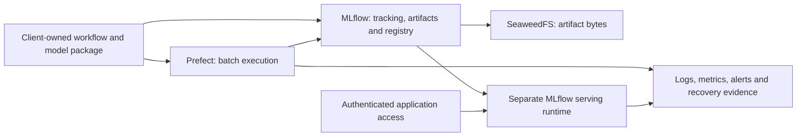

# MLOps Platform

Shared infrastructure for applied ML: run research and batch workflows with Prefect, track and retrieve model artifacts with MLflow, and serve packaged models through MLflow Model Serving. PostgreSQL holds service metadata and SeaweedFS stores artifact bytes.

Solutions own their scientific code, model packages and deployment requests. They consume service interfaces; the infrastructure has no catalog of solution repositories or prescribed project names. Adding a client does not require a platform release.

The production target covers **both batch operation and online prediction**. The [requirements and acceptance record](docs/requirements.md) separates that target from capabilities already verified, and identifies the hosting, service objectives and operating decisions still needed. [Design decisions](docs/design-decisions.md) explain the topology, resource budgets and deployment boundaries.



The diagram describes the target architecture. The current batch/artifact controls have integration evidence; the authenticated serving path and broader production operations have outstanding acceptance work listed in the requirements.

## Connect an application

Applications receive approved MLflow and Prefect endpoints, application credentials and, for container clients, an approved client network. They do not receive database or S3 administration credentials. Each client owns its experiment, registered-model and deployment names, artifact namespace, workload environment and resource request.

An authorized operator can provision a client-supplied experiment contract using `mlops_platform.registry.ensure_experiment(contract)`. The helper accepts an explicit experiment name and artifact namespace, reuses a matching active experiment and rejects namespace drift. It neither grants access nor registers or deploys a model. [Contract example](configs/README.md).

Existing installations retain their current endpoints and identities. The audited shared MLflow endpoint is `http://127.0.0.1:5500`; the separately managed Prefect installation has not been adopted by this repository. [Existing deployment and adoption](docs/adoption.md).

## Deploy the infrastructure

Host requirements: Docker Engine with Compose and Python 3.12 or 3.13 on Linux or WSL. The checkout-local launcher uses only Python's standard library; starting containers does not install the service SDKs on the host. Initial image builds require internet access. Python dependencies inside the runtime image are locked separately.

```bash
./infra deploy
```

This explicit operation checks Docker, creates protected state for a new deployment or validates existing state, checks Compose configuration, builds and starts services with readiness checks, then reports endpoints and credential-file paths. Repeating it reuses the recorded identity and credentials. Incomplete state is an error, not a reason to generate replacement passwords. Starting existing containers/volumes also requires the matching state ownership marker; unlabelled older deployments need a reviewed adoption rather than an automatic restart.

```bash
./infra status
./infra logs mlflow --tail 100
./infra logs prefect --follow
./infra stop
```

`stop` removes the selected deployment's containers while retaining data volumes and credentials. `./infra check` validates existing state and Compose configuration without starting services; `./infra init` is available for deliberate preparation but is not a required first step. See `./infra deploy --help` for separate named state and port options. Relative state paths resolve against this checkout, even when the launcher is called from another directory.

Defaults use ports **5501** for MLflow and **4201** for Prefect, avoiding the audited shared services. Credential values are never printed; their files are under `.local/development/secrets/`. The default deployment retains its established Compose and network names. New separately named deployments use scoped client networks; old state retains its stored network. A repository rename does not migrate running resources.

Docker Compose remains the deployment engine. For native diagnostics, supply the recorded identity and state explicitly:

```bash
docker compose --project-name mlops-platform-development \
  --env-file .local/development/compose.env --file compose.yaml ps
```

The launcher operates the Docker context selected by the operator. It does not provision a remote host or adopt an existing deployment automatically. Production deployment uses a reviewed target and configuration with the access, capacity and recovery requirements below.

## Batch and online model execution

Batch jobs run in client-owned, digest-pinned images with explicit resources, input/output mounts, deadlines and quality gates. [The batch runner](docs/batch-operations.md) records stage outcomes and reuses verified completed computation during recovery. Its recorded saved-model case is historical integration evidence; platform startup and CI use independent fixtures.

[examples/project_flow.py](examples/project_flow.py) accepts client-supplied project, flow and deployment names. It requires an explicitly selected Prefect endpoint. Its opt-in host runner has Docker access; service containers and the optional process worker do not receive a Docker socket.

Online prediction uses **MLflow Model Serving in a separate model runtime**, rather than adding model dependencies to the tracking server. The client supplies a supported MLflow Model, preprocessing, signature, input example and reproducible environment. Deployment resolves an exact model version and image; candidate prediction tests precede traffic switching, and rollback restores a verified prior deployment. Changing a registry alias alone is not a running-server rollout. [Serving contract and acceptance](docs/requirements.md#model-packaging-and-online-deployment).

An artifact upload or checkpoint bundle is not automatically an MLflow Model. Current tracking and batch receipts do not claim that an authenticated model endpoint, rollout or rollback has been deployed.

## Production operating requirements

Private database/storage networks and loopback application bindings provide the current access boundary. Production exposure needs the selected TLS/authentication boundary, including the prediction endpoint. Health checks and stage logs are present; service/request metrics, alert delivery, off-host backups and a measured restoration drill remain acceptance requirements.

The checked-in CPU, memory and storage settings are deployment defaults, not throughput or capacity guarantees. Service processes, batch workloads and model-serving runtimes need separate measured budgets. In particular, the small SeaweedFS storage configuration must be sized against artifact growth and retention. [Sizing and boundary rationale](docs/design-decisions.md).

Hosting, service ownership, availability and latency targets, batch deadlines, maintenance windows, recovery objectives and retention determine the production topology. Compose can remain the service engine when it meets those objectives; a particular cloud or Kubernetes deployment is not assumed. [Requirement status](docs/requirements.md#production-operation-and-evidence) · [Operations](docs/operations.md).

## Develop and verify

Development and host-side workflow execution additionally use [uv](https://docs.astral.sh/uv/):

```bash
uv sync --locked
uv run pytest -q
uv run python scripts/verify_model_serving.py --output .local/serving-check
./infra verify
```

The serving check packages a synthetic MLflow Model, checks health/schema/prediction parity and explicitly restarts the endpoint through v1 → v2 → v1. It tests runtime version selection and rollback, not zero-downtime traffic routing, authenticated ingress or a production model deployment.

The isolated infrastructure verification command creates temporary service credentials and an independently named Compose deployment. It checks authenticated APIs, Prefect task execution and failure propagation, MLflow artifact-byte readback, the actual stored object, and persistence after container recreation. It removes only that test deployment's resources and retains a private receipt under `.local/`. CI runs the same test. Container recreation is distinct from restoring an off-host backup.

[Current contract/CLI/serving verification](docs/contract-validation.json) records the reviewed source and executed scope. [Earlier verification receipts](docs/verification.json) retain their original source identities and scope. [Capability assessment](docs/mlops-assessment.md) records earlier evidence; the current [requirements](docs/requirements.md) govern the expanded production target. W&B remains an optional client-side integration rather than an authoritative platform dependency.
